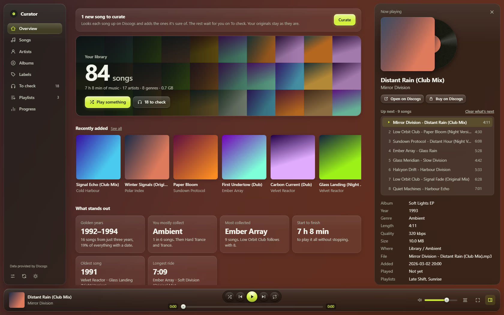
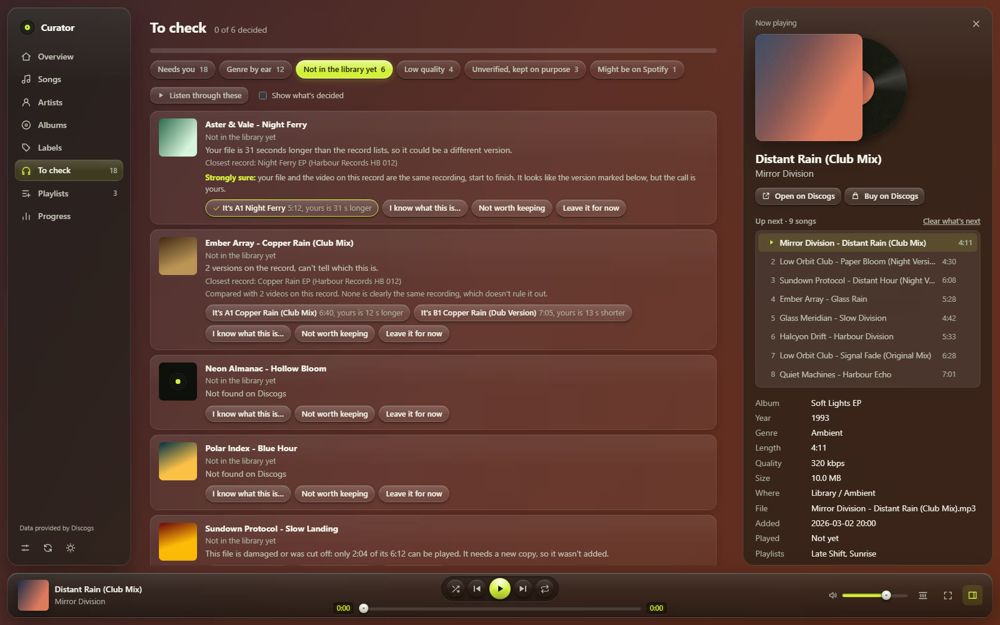
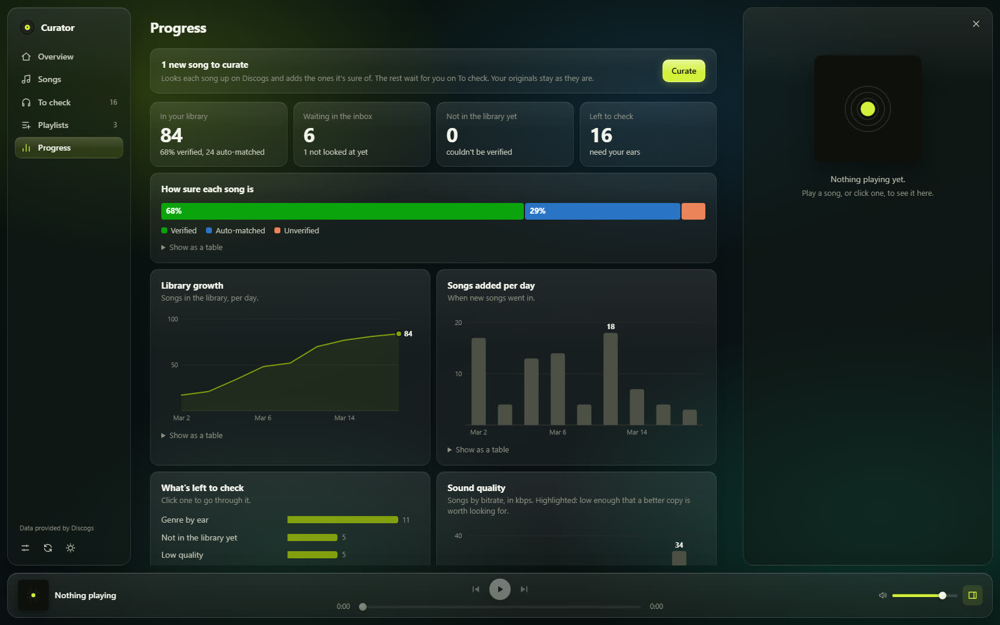

# Pressling

A free, open-source companion for your own music files: a player with a curator built in, which checks every song
like a test pressing before it goes on the shelf. The package is `music-curator` and the command is `curator`.

Curate a local music library, on its own or with an AI agent: every song is checked against
[Discogs](https://www.discogs.com), the exact version is settled by track length (and, with an agent, audio
fingerprints and other sources), and a clean copy is written with consistent tags, filename and cover. Nothing is
changed in place, and every change is logged.

Built for people who keep their own files — vinyl-era electronic music, rips, rare tracks — and play them in
Spotify (local files), Plex, Navidrome, foobar2000, a phone, …

> Status: early (0.1). The workflow was developed on a real library of 90s acid/trance. Only Windows has been tried so far.



<sub>The screenshots show a made-up library.</sub>

## Get started

There are two ways to use it, and you can mix them:

- **On its own.** Press **Curate** on the page. The app looks up each song and adds the ones it's sure of, and you settle the rest by ear.
  Then **Double-check** what it added, if you like: listen, look over what it wrote, and say whether it's right.
  See [Set it up by hand](#set-it-up-by-hand) and [Curate with no AI](#curate-with-no-ai).
- **With an AI app** that can run commands on your computer, such as Claude Code, Codex, Cursor or Gemini CLI. It does the hard
  cases too, and it can do the whole setup for you:

1. Download this repository and unzip it (or `git clone` it).
2. Open the folder in your AI app.
3. Say **"Set up music-curator for me."**

It checks what's missing and asks before installing anything. The one part only you can do is getting a free Discogs token, and
it walks you through that. Then your library opens in your browser and you pick your folders.

After that, just say what you want:

| Say | What happens |
|---|---|
| "Curate my new downloads" | The app's Curate goes first, then your AI app double-checks everything: tags, cover, that the audio is the right version, and other sources when Discogs doesn't have a song. A clean copy goes into your library. Anything it can't verify waits for you in To check, and so does any better-sounding copy it finds, with a link: your file only changes if you say so. |
| "Open my library" | The page opens in your browser. |
| "Apply my answers" | What you decided in To check gets carried out. |

## What makes it different

Taggers like Mp3tag, MusicBrainz Picard and beets match metadata. This toolkit also answers *"is this file really
that version?"*:

- **Version proof.** Compares your file's audio fingerprint with a reference recording, so "A-side or Barn Mix?" is
  answered from the audio, not guessed. (Using the videos linked on a Discogs release as the reference needs the optional yt-dlp.)
- **Speed and edit detection.** Finds rips that play a few percent fast (a common upload trick) or were cut
  short, by aligning 20-second fingerprint chunks.
- **Human in the loop.** Clear "held back" reasons, genre toss-ups to settle by ear, a report per batch.
- **Player switch-overs.** The log keeps old vs new tags, so you know which playlist entries to re-add.

## How it works

```
inbox files ──parse──▶ items.json ──resolve──▶ ready / review / notfound
                                       │            │          │
                                       │       scan · videos   other (MusicBrainz, YouTube)
                                       │       same · drift    ost (game music)
                                       ▼            ▼          ▼
                                   plan.json ──write──▶ library/<genre>/<artist> - <title>.mp3
                                                       + log.csv (old → new) + report
```

The Curate button runs the plain version of these steps by itself. An AI agent runs all of them and talks to you; see
[AGENTS.md](AGENTS.md) for the full workflow it follows. You can also run every step by hand.

## Requirements

- Python 3.11+ (standard library only)
- `ffmpeg` and `ffprobe` on PATH, built with **chromaprint** (`ffmpeg -hide_banner -muxers` lists `chromaprint`)
- A free Discogs personal access token (<https://www.discogs.com/settings/developers>), saved as described
  [below](#your-discogs-token)
- Optional: [yt-dlp](https://github.com/yt-dlp/yt-dlp), to compare your files with videos online and find official YouTube uploads. Whatever it fetches is deleted right after the comparison

It curates MP3, FLAC and M4A files. Each stays the type of file it is, and the audio is copied as it is, never re-encoded. Other formats still show up and play on the page, but they're skipped when curating.

## Set it up by hand

Install it into a virtual environment: a private copy of Python just for this app, so nothing else on your computer changes.
(On recent Linux, and with Homebrew's Python on macOS, a plain `pip install` is refused anyway.) In this repository's folder:

Windows:

```powershell
python -m venv .venv
.venv\Scripts\python -m pip install -e .
.venv\Scripts\curator serve
```

macOS and Linux (on Debian and Ubuntu, `sudo apt install python3-venv` first if `venv` isn't there):

```bash
python3 -m venv .venv
.venv/bin/python -m pip install -e .
.venv/bin/curator serve
```

`curator serve` opens your browser, where you pick your library and downloads folders. `curator doctor`, run the same way,
checks that everything is in place. From then on, that full path is how you start the app. If you'd rather type just `curator`,
activate the environment first in each new terminal: `.venv\Scripts\activate` on Windows, `source .venv/bin/activate` on macOS and Linux.

Prefer a config file? `curator init` writes a `curator.toml` in the current folder.

**How it fits together:** you put downloaded songs in your downloads folder and press **Curate**, or ask your AI app to curate
them. Finished songs are copied into your library, sorted by genre, and your originals stay in downloads until you say they can
go. Songs that can't be settled stay put and show up in To check.

### Your Discogs token

Lookups need a free token from <https://www.discogs.com/settings/developers>. The easiest place for it is a text file called
`.env` next to your settings, with one line (`curator doctor` says which folder, and so does the page):

```
DISCOGS_TOKEN=your token here
```

An environment variable called `DISCOGS_TOKEN` works too, and wins if you have both. The app only ever reads the token and sends
it to Discogs. Keep the file out of anything you share: `.env` is already in this repository's `.gitignore`.

## Curate with no AI

**Curate** on the page (or `curator curate`, with `--dry-run` for a preview) looks up everything waiting in your downloads folders.
With nobody double-checking, the rules are strict. A song goes in only when:

- its artist and title match a track on a record, and any mix named in the file is the one on the record
- the length is within 20 seconds of the record's, when the record lists one
- it isn't already in your library
- it plays all the way through: a broken download still has a good name, so each song is played through first, which takes about a second

Those songs are marked **Auto-matched**, so you can tell them from the ones checked more closely. Everything else waits on To check
with the reason and the versions found: listen, then click the one it is, or type what it really is, and press Curate again.

**Double-check** (on To check, and in each song's panel) is where you check the Auto-matched songs yourself. Each one shows what Curate
wrote: the old and new file names, the tags, the cover and its size, the record it matched, and the versions on that record with their
lengths next to yours. The ones worth a closer look come first, with the reason: a length further off, a version picked from several by
length, one you picked yourself, a genre toss-up, a low bitrate, a small cover or a better copy found. **Looks right** marks the song
Verified straight away, the way `curator verified` does, and only writes that in the log. **Not right**, with a note if you like, takes
it out of your library the next time you press Curate. The copy goes to the Set aside folder while your original is still in your downloads,
or back to your downloads under its old name if it isn't. Then the song is looked up again and waits on To check with your note, and only
your answer puts it back. Quick mode works here too: 1 for Looks right, 2 for Not right, U to undo.

On one real library of 518 songs, replayed from their original messy names, 55% went in by themselves and one disagreed with the
verified answer, only in how the title was spelled. The rules were tuned on that same library, so expect a little less on yours.
Files nobody can look up, like nightcore edits or unofficial remixes, always wait for you or an agent. An agent adds what Curate can't
do: reading odd names, settling versions from the audio, checking other sources, and looking for better-sounding copies.

**Comparing audio (optional).** If you have yt-dlp, Settings has a switch for this, off by default (`compare_audio = true` under `[curate]` does the same). When Curate finds the record but can't tell which version your file is, it fetches the video linked on that record, compares it with your file, and deletes it straight after. A match is never treated as proof, because a video can be mislabelled or be another mix from the same record. So nothing goes in because of it: To check says when the app is strongly sure your file is the same recording, and you decide.

## See it in your browser

`curator serve` opens a small local page (127.0.0.1 only, nothing to install):



- **Overview**: a wall of your covers, what you added last, your peak years, top genres, artists, labels and countries. Once you've played a few songs it also shows what you listen to most. A song counts as played once you've heard half of it, or 4 minutes if that comes first.
- **Songs**: search and filter everything, play it, see how each song was verified and what the file used to be called, and jump to its Discogs page to check it or buy the record. **Export** takes whatever you've filtered: an M3U playlist, a spreadsheet, or copies in a folder or on a USB drive, with a playlist that goes along with them, for your phone, car or another player.
- **Artists**, **Albums** and **Labels**: browse your library by cover, play a whole record, and click through to its songs.
- **Playlists**: make your own, add songs to them from anywhere in the app and drag them into the order you want, or **Import** `.m3u` and `.m3u8` files from another player. Each line of a file is matched to a song you already have, and you're told which ones it couldn't find. Once you've pressed Check Spotify, your Spotify playlists play here too, as far as you have the songs as files. Each song's details say which of them it's on, and the Songs page can show just the songs that are on none. Streamed songs you don't have are left out. **Save as files** writes them all as `.m3u8` playlists that other players can open.
- **Now Playing**: click the cover in the play bar for the big view, with what's up next, which you can drag into another order. The seek bar shows the shape of the song, so you can jump straight to a breakdown or a drop.
- **Crossfade**: a button on the play bar blends each song into the next over 3, 6 or 10 seconds. It leaves songs from the same record alone, since they may run into each other on purpose.
- **Effects**: pictures made from the sound on Now Playing, in the colors of the record: Ribbon, Bars, Trails, Stars, Halo and Space, each with its own list of styles, from LEDs and an oscilloscope to fireworks, and sliders under **Adjust** for each one, with 100% as the default. Space is a flight past nebulas, galaxies, planets and black holes that changes course on the beat, with shooting stars on the hi-hats. Visitors come by in any of them now and then (saucers, jellyfish, a face peeking up, an astronaut, a cow) and stay when the picture changes, and one effect turns into the next in a fade, a spin, a melt or like an old TV switching off. **Morph** makes that happen by itself every minute or so, into any style of any effect, best of all when the beat comes back after a break. **V** picks the next one and **F** shows just the picture, with the controls coming back when you move the mouse. **All pages** keeps it going faintly behind the rest of the app.
- **Your color**: Settings changes the green of the buttons to another color, or to the strongest color on the record that's playing.
- **Favourites**: the heart on the play bar, Now Playing, the song panel and song rows adds to a local playlist called Favourites, which sits first on the Playlists page and works like any other.
- **More than one genre**: a file keeps the one genre you settled on, but the app also shows every style Discogs lists for its record, and finds the song under any of them. On a compilation those are the whole album's, so they're only shown. Kept in `styles.json` next to the log; Curate fills it in.
- **Glow, Flash and Sparkle**: separate switches, on the play bar and on Now Playing. Glow makes the buttons light up softly on each kick, and Flash does the same to the background. Sparkle follows the hi-hats instead: the dots in the clock tick and now and then a glint catches the record or the play button. All three are off until you turn them on.
- **On your phone**: `curator serve --lan` also opens the app on your home network and prints a private link. Open it once on the phone and it remembers. Only devices on that network with the link get in, and choosing folders, copying files and Spotify sign-in stay on the computer. It's plain HTTP, so keep it to a network you trust.
- **Packs**: under Settings you can export how you've set the app up as a small file, and import someone else's: jokes, road signs, which genre gets which mood, sliders and surprises. A pack only holds words, numbers and colors, so it can't run anything. See `examples/example.curator-pack.json` to write one by hand.
- **Surprises**: now and then the app nods along to the kick, and once in a while it dances. Visitors drop by the app itself too: a saucer borrows a cover and gives it back, a face peeks over the play bar, a cow gets taken from it, a little one hangs on a thread from the top. Settings says how often, how strong and how long, or turns them off, and the nodding can stay on all the time.
- **Mood**: the background and the way a kick lands change a little with the genre of what's playing: softer for trance, yellow for acid, darker and quicker for hardcore. Settings turns it off.
- **White labels and stickers**: a song with no verified cover shows as a blank promo record with its name stamped on it. Sleeves carry small stickers for what the curator knows: a seal when every song on the record is verified, a yellow label when something waits for you on To check, and an orange one when a better copy may exist.
- **Radio**: Start radio on any song and it keeps playing others like it from your library, going by genre, label, year, artist and the playlists they share. Clear what's next to stop it.
- **Even volume**: a button on the play bar that turns loud songs down to match the rest. It never raises a song, because nearly every file already reaches full scale and raising it would distort it, so quieter songs stay as they are. Each song is measured with ffmpeg the first time it's needed, and the file isn't changed.
- **To check**: the questions only ears can answer (genre toss-ups, songs that couldn't be verified), with the audio right there. **Quick mode** takes them one at a time: press a number to answer and the next song starts. **Double-check** has the songs Curate added with nobody checking, for you to confirm or take back out (see [Curate with no AI](#curate-with-no-ai)).
- **Progress**: what's waiting in the inbox, how sure each song is, library growth, latest changes.



The first time it asks where your library and downloads live, and you can change them later under Settings. Picking a
folder never moves any music. The app keeps its log, answers and cache in a `_curation` folder next to the library, and its
settings in your user profile. Browsing only ever reads your music. Your answers go to `decisions.json` next to the log, with play counts in `plays.json` and the playlists you make in `own_playlists.json` beside it. The
one thing on the page that changes your library is the Curate button, and the only outside service it talks to is Discogs (plus YouTube, if you turn on comparing audio). Export never changes your library, and copying only ever adds files to the folder you pick.

When you've answered To check, press **Curate** at the top of that page. It adds the songs you identified and carries out your other answers that need no research: songs
you said aren't right on Double-check, genre changes, which also move the song to the new genre's folder, and, if you tick the box, the songs you marked not worth keeping. `curator apply` does the same from a terminal (`--dry-run` to preview, `--set-aside` for those songs).
Nothing is deleted: old copies go to a `Set aside` folder next to the log, which you can empty whenever you like. Answers that need
research, like finding a better copy, stay on the list for your agent.

Optional `[paths]` keys feed the To check page: `review` (a folder of songs waiting for a decision) and `review_list` (a Markdown
file with one `- **Artist - Title**: reason` per song).

### Checking Spotify (optional)

Your local playlists live in the app, and Spotify is something it checks. Spotify doesn't let apps add or remove local files in playlists, so the **Spotify to-do** tab on the Playlists page lists what's for you to do by hand. Songs you
accept under Playlist ideas, or press **Add to Spotify** on, wait under To add, for you to drag in. **Send to Spotify** on a local playlist makes it on Spotify and lists its songs the same way. It asks for permission to change your playlists when you press it, and if Spotify won't let your app make playlists, you make one with the same name yourself. A **Check Spotify** button confirms what arrived and lists under To
remove the local entries with no matching file (Spotify shows those greyed) and any second copies, with where they are in the playlist.
It only reads your playlists, the sign-in stays in memory until the app closes, and a playlist that hasn't changed isn't read twice. If entries to remove are spread through a playlist, **Move all to the bottom** gathers them so you can select them in one go. That button asks Spotify for permission to reorder your playlists when you press it, and it never removes anything.

Check Spotify also searches Spotify for the songs still waiting in your downloads and Review, once per song. Likely matches appear on To check as **Might be on Spotify**, going by name and length, because Spotify gives apps no audio to compare. Open it, listen, and if it's the same recording, choose playlists and the app adds the streamed song to them. Your file stays where it is until you say otherwise.

To turn all this on, create an app at <https://developer.spotify.com/dashboard>, add
`http://127.0.0.1:8888/callback` as its redirect URI, and put its Client ID in `curator.toml`:

```toml
[spotify]
client_id = "your client id"
```

## Commands

| Command | What it does |
|---|---|
| `init`, `doctor` | starter config; environment check |
| `curate [--dry-run]` | curate with no AI: add the songs the evidence settles, leave the rest on To check |
| `verified SONG… --how TEXT` | record that Auto-matched songs were checked properly, like Looks right on Double-check (for your agent, after Curate) |
| `parse OUT [DIR…]` | read inbox folders (names + tags) into items |
| `resolve ITEMS OUT` | Discogs match and tag decisions |
| `scan ITEMS` | every pressing/version of a song with lengths |
| `videos ITEMS OUT` | fingerprint files against Discogs-linked videos |
| `other ITEMS OUT` | MusicBrainz and official YouTube uploads |
| `ost ITEMS OUT` | game-soundtrack lookup |
| `better ITEMS OUT` | find better copies and compare them with yours (yt-dlp); gives links and keeps no audio |
| `maybe-better SONG URL --why TEXT [--checked]` | leave a link to a possibly better copy on To check, to open or ignore (for your agent) |
| `same COPY REF`, `compare A B`, `drift COPY REF` | same-recording tests (`REF` can be a YouTube link, with yt-dlp) |
| `write PLAN [--dry-run]` | write tagged copies + cover into the library, append to the log |
| `serve [--port N] [--no-browser]` | open the library in your browser |
| `decisions` | list what you decided in the browser |
| `apply [--dry-run] [--set-aside]` | carry out your browser answers that need no research |
| `serve --lan` | also open the app on your home network, behind a private link, for your phone |
| `genres` | get every style Discogs lists for the records in your library, for the page (files keep their one genre) |
| `suggest PLAYLISTS [NAME] [--count N]` | suggest playlists your songs are a confident fit for, to judge by ear on To check (experimental) |
| `discogs …`, `vgmdb …` | raw clients |

## Your rules

The defaults follow one person's taste; change them in `curator.toml` (`[rules]`) and
[docs/RULES.md](docs/RULES.md): filename pattern, folder layout, artist joiner, album for singles, keeping your
existing genres, game/TV soundtrack folders.

## Using it with AI agents

- **Any agent:** point it at [AGENTS.md](AGENTS.md).
- **An app with its own browser**, like the Claude desktop app: open the page right beside the chat, so you and the agent are looking at the same thing. This is the best way to use the two together.
- **Claude Code:** [CLAUDE.md](CLAUDE.md) imports AGENTS.md; a skill is in [skills/music-curator](skills/music-curator).

## Notes and limits

- Meant for files you already have. It doesn't download music for you to keep: the optional yt-dlp only fetches audio to
  compare it with your file, and that audio is deleted straight after. Better copies it finds are left as links. Using it is your
  responsibility; check the terms of the sites you use and your local law.
- Discogs data: use your own token, stay within the rate limits (the client throttles and caches), and credit
  Discogs where you display its data ("Data provided by Discogs"). Cover images are for your personal tags.
- MusicBrainz data is CC0; please keep its 1 request/second limit.
- VGMdb (game music) blocks automated access; the `vgmdb` client uses a volunteer mirror that is often down.
- Fingerprints come from [Chromaprint](https://acoustid.org/chromaprint) via ffmpeg.

## License

[MIT](LICENSE). Data from Discogs, MusicBrainz and Spotify stays under their own terms.
